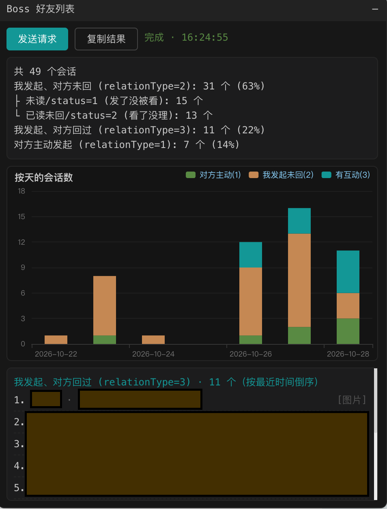

# boss-spider

Boss直聘聊天会话分析油猴脚本（Tampermonkey UserScript）。

在 `www.zhipin.com` 页面注入浮窗，请求 `getGeekFriendList.json` 接口（同源请求自动携带 Cookie），对返回的会话列表做统计：

- 关系类型统计：`relationType=1`（对方主动发起）/ `2`（我发起、对方未回）/ `3`（我发起且对方回过）
- `relationType=2` 再按最后一条消息的 `status` 细分：未读（1）/ 已读未回（2）
- ECharts 堆叠柱状图按天展示三类会话数量
- 单独列出所有 `relationType=3` 会话的公司名与 HR/职位名称
- 一键复制统计结果 + 原始 JSON（不出现在页面上）

## 使用

1. 安装 [Tampermonkey](https://www.tampermonkey.net/) 浏览器扩展
2. 安装 `userscripts/boss-friend-list.user.js`
3. 打开任意 zhipin.com 页面，右上角点击「发送请求」

联系人列表由脚本自动通过 `geekFilterByLabel` 接口拉取（最近 30 天内有沟通记录的对象），
无需手动填写；如需只统计部分对象，可在脚本顶部 `FRIEND_IDS` 手动指定 uid 列表。

## 免责声明

仅供个人求职场景下分析自己的聊天数据使用，请勿用于批量采集或骚扰，遵守目标网站的服务条款与相关法律法规。

## 预览

