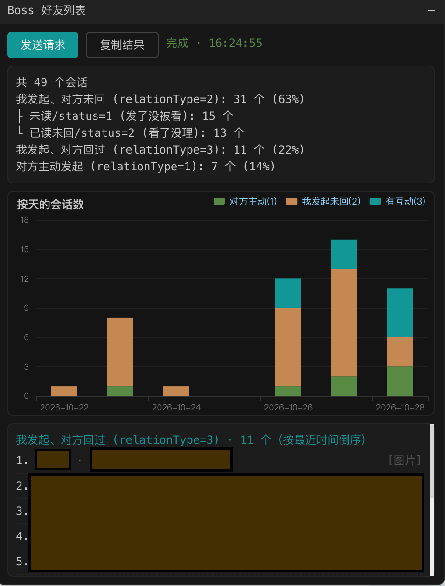

# boss-spider

Boss直聘聊天会话分析油猴脚本（Tampermonkey UserScript）。

在 `www.zhipin.com` 页面注入浮窗，请求 `getGeekFriendList.json` 接口（同源请求自动携带 Cookie），对返回的会话列表做统计：

## 特性

### 统计与漏斗

- 关系类型统计：`relationType=1`（对方主动发起）/ `2`（我发起、对方未回）/ `3`（我发起且对方回过）；`relationType=2` 再按最后一条消息的 `status` 细分：未读（1）/ 已读未回（2）
- 转化漏斗：用 ECharts funnel 图展示「打招呼总数 → 相互交流」，分母为 `1+2+3`、分子为 `relationType=3`，下方附「我发起」(2+3) 与「对方发起」(1) 分支转化率
- 单独列出所有 `relationType=3` 会话的公司名与 HR/职位名称
- ECharts 堆叠柱状图只展示 **最近 7 天**（更早的数据仍计入统计与清单）
- 一键复制统计结果 + 原始 JSON（不出现在页面上）

### 请求与缓存

- 联系人列表由 `geekFilterByLabel` 接口自动拉取，无需手动填写；如需只统计部分对象，可在脚本顶部 `FRIEND_IDS` 手动指定 uid 列表
- 会话详情按最后消息时间 **每 3 天一个窗口分批请求**（单次最多 40 个 id），再汇总去重，避免 `friendIds` 过长导致 `1092 操作失败`
- 某个窗口失败时自动对半拆分重试；失败的窗口与业务码都会写进日志
- 拉到过的会话详情存进 `localStorage`，下次运行先按 **friendId + lastTS** 做 diff：时间没变的直接读缓存，只有变化的才发请求（缓存超过 12 小时会强制刷新一次，避免已读状态过期）
- 浮窗上有「清缓存」按钮，也可以 `__bossFriendListDebug.clearCache()`

### 界面

- 手风琴式折叠面板：概览统计 / 转化漏斗 / 按天趋势 / 已回复清单 / 调试日志，展开状态持久化到 localStorage
- 浮窗可拖动，面板内容超出高度时内部滚动；每个折叠标题右侧显示摘要（总数 / 转化率 / 条数等）
- 请求出错或窗口失败时，调试日志区自动展开

### 调试

- 页面内实时调试日志：每次请求的 URL、id 数、body 大小、HTTP 状态、业务码、耗时；同一份日志也会输出到 DevTools Console
- 调试对象 `window.__bossFriendListDebug` 可在 DevTools 里查看各窗口、原始响应、漏斗、缓存命中与最终汇总结果

## 使用

1. 安装 [Tampermonkey](https://www.tampermonkey.net/) 浏览器扩展
2. 安装 `userscripts/boss-friend-list.user.js`
3. 打开任意 zhipin.com 页面，右上角点击「发送请求」

联系人列表由脚本自动通过 `geekFilterByLabel` 接口拉取（最近 30 天内有沟通记录的对象），
无需手动填写；如需只统计部分对象，可在脚本顶部 `FRIEND_IDS` 手动指定 uid 列表。

## 调试

浮窗底部有「调试日志」折叠区，默认收起，点击展开；请求出错时会自动展开。点击工具栏的「复制日志」可直接带走全部记录。
在 DevTools Console 中执行 `__bossFriendListDebug` 可查看：

- `logs`：页面内显示的全部日志
- `buckets`：本次按时间拆出的请求窗口
- `responses`：每个窗口的业务码、失败时的原始响应
- `mergedList`：去重后的最终会话列表
- `funnel`：漏斗分子/分母与转化率
- `cache`：本次缓存命中/未命中/过期数量
- `clearCache()`：清除本地缓存（同浮窗「清缓存」按钮）

本地缓存在 `localStorage` 的 `boss-friend-list-cache-v1` 键下，只存在自己浏览器里，不会上传。

## 免责声明

仅供个人求职场景下分析自己的聊天数据使用，请勿用于批量采集或骚扰，遵守目标网站的服务条款与相关法律法规。

## 预览

